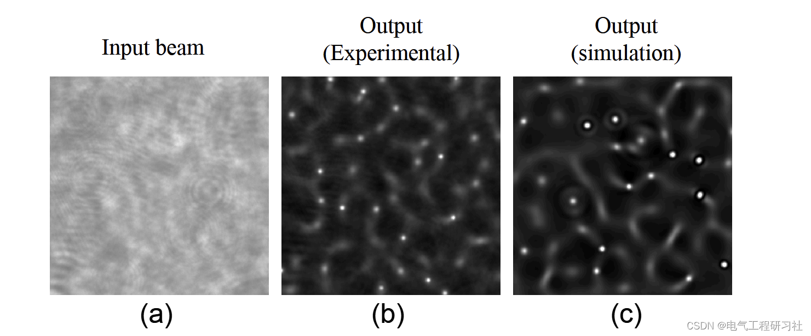
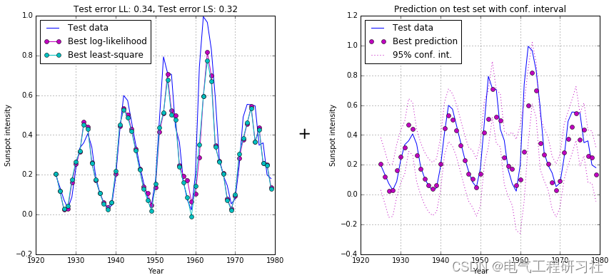
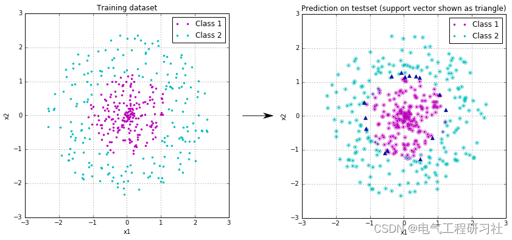

# [Signal Processing]Nonlinear Signal Processing (Python Code Implementation)

1. Overview of the study
This paper has experimentally and numerically investigated the propagation of femtosecond pulses in Kerr media. The nonlinear propagation in Kerr materials leads to the formation of optical patterns and filaments [1]. We studied the similarity between the propagation of light pulses in Kerr media and the evolution of a fluid dynamic system, and suggested using an optical system to simulate fluid dynamics.
The experiments were conducted using a TiSapphire laser amplification system that produced 150 femtosecond pulses with an energy of up to 2 mJ at an 800nm wavelength. Dimethyl sulfide was chosen as the nonlinear medium due to its large nonlinear coefficient. A collimated beam with a diameter of 5 mm was launched into the nonlinear medium, and the output beam profile was imaged on a CCD camera to obtain different propagation lengths. Figure 1a shows the image of the central part (0.5 meters x 0.5 meters) of the input beam, while Figure 1b shows the output beam after passing through a 10 mm nonlinear medium. Modulation instability causes the beam to split into patterns of connecting lines (constellations) and bright spots (filaments). The curve of the output beam can be repeated multiple times in laser shots if the input beam remains constant. The constellations appeared before the filaments, and they remained constant as the beam propagated [2] [3]. After the constellations appeared, the lines began to decompose into increasingly fine filaments. These filaments reached a stable diameter of 12 micrometers and propagated several millimeters before divergence. Increasing the energy of the input beam led to the beam breaking down and forming more filaments at shorter distances. However, neither the size nor intensity of the filaments changed. We also observed cone-shaped emission from filaments interacting with the constellations, which facilitated the formation of new filaments.
This study investigated the propagation of femtosecond pulses in Kerr media through both experimental and numerical methods. The work also explored the similarities between the propagation of light pulses in Kerr media and the evolution of a fluid dynamic system, and proposed the use of an optical system to simulate fluid dynamics.
2 Simulation Tests
Figure 1. Amplitude of the measured input beam (a) used as an input for numerical simulation. The experimental (b) and simulated beam profiles (c) show good consistency. The image is 0.5 mm x 0.5 mm.
The study of using optical systems to calculate the evolution of fluid systems has been conducted. The advantage of using optical systems is their inherent high speed, parallelism, and configurability. To establish a direct correspondence between optical and classical fluid mechanics, it is necessary to link the quantized vortex lines with distributed vorticity. Continuous vorticity can be approximated by spatial averaging over discrete vortices in the optical system. In ordinary fluids, vortex generation is primarily due to obstacles in the flow, whose boundaries are "non-slip" in most cases. Naturally generated vorticity on such boundaries diffuses into the main flow through viscosity. In optics, there can only be one "free slip" boundary enforced by refraction index. In completely incompressible fluids, "free slip" boundaries only generate potential flows and do not produce vorticity. We have found that by properly selecting optical boundary conditions, vorticity can be produced in optical systems.
Editor
Editor
3. Python code and article detailed explanation. This article only showcases a portion of the code, all code and detailed articles can be found in:
# -*- coding: utf-8 -*-
​  

## Images

<!-- PAYMENT_BLOCK -->

## Get this dataset

- Payment link (Stripe): [Buy now](https://buy.stripe.com/3cs8yP7sY87d0vu9AB)
- Payment QR code: 

<!-- /PAYMENT_BLOCK -->
